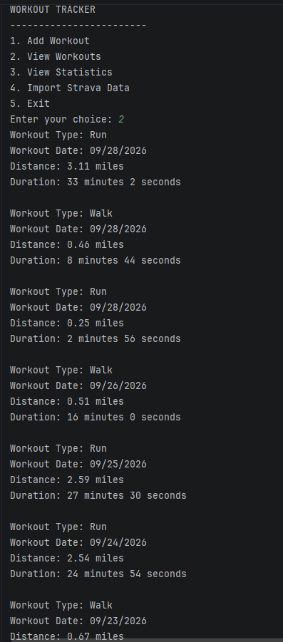
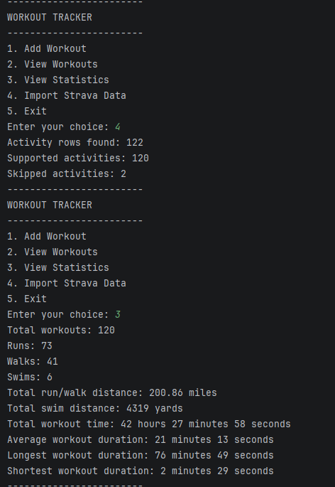
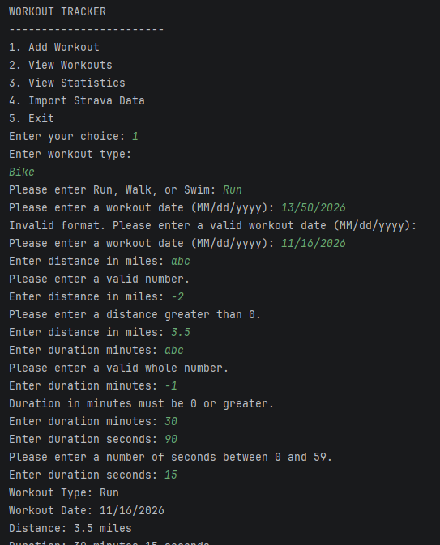
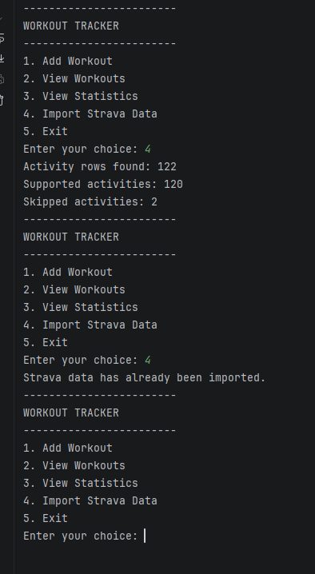

# WorkoutTracker

## Project Description

WorkoutTracker is a Java console program used to organize and analyze workout information. The user can manually add Run, Walk, or Swim workouts and can also import activity data from a cleaned Strava CSV file.

The program stores the workouts in an `ArrayList` and allows the user to view individual workouts or calculate statistics such as workout counts, total distance, total workout time, average workout duration, and longest and shortest workout durations.

## Why I Chose This Project

This project gave me a way to combine several Java concepts from the course into one program that has a practical purpose.

I chose to create a workout tracker because exercise and workout tracking are already part of my regular routine. I use Strava to record activities, so I wanted to create a program that could use some of my real workout data instead of using randomly created data.


## Java Concepts Used

This project uses several Java concepts covered throughout the course:

- **Classes and Objects** - The `Workout` class represents individual workout objects.
- **Methods** - Helper methods are used to organize tasks such as adding workouts, displaying workouts, calculating statistics, displaying the menu, and importing Strava data.
- **Decision Making** - `if` statements are used for menu choices, workout types, distance units, and input validation.
- **Loops** - Loops are used for the main program menu, input validation, and reading activity records from the CSV file.
- **ArrayList** - Workout objects are stored in an `ArrayList<Workout>`.
- **Exception Handling** - `try` and `catch` are used to handle invalid dates and file errors.
- **File I/O** - The program reads activity information from a Strava CSV file.
- **Streams** - Java Streams are used to filter workout types and calculate counts, totals, averages, minimums, and maximums.
- **Java Time** - `LocalDate` and `DateTimeFormatter` are used to store, validate, and display workout dates.
- **String Processing** - Strings are compared and processed when validating workout types and reading CSV records.

## Features

The program includes the following features:

- Add Run, Walk, or Swim workouts manually
- Validate workout type, date, distance, minutes, and seconds
- View all workouts
- Import workout history from a Strava CSV file
- Convert Strava distances from meters to miles for Runs and Walks
- Convert Strava Swim distances from meters to yards
- Skip unsupported activity types during import
- Prevent the Strava file from being imported more than once during the same program session
- Display the number of Runs, Walks, and Swims
- Calculate total Run/Walk distance
- Calculate total Swim distance
- Calculate total workout time
- Calculate average workout duration
- Find the longest workout duration
- Find the shortest workout duration
- Handle empty workout lists without causing errors

## How to Run

1. Open the `WorkoutTracker` project in IntelliJ IDEA.
2. Make sure a Java JDK is selected for the project.
3. Confirm that `activities_capstone.csv` is located in the `data` folder.
4. Open `Main.java`.
5. Run the `Main` class.
6. Choose an option from the menu:

```text
1. Add Workout
2. View Workouts
3. View Statistics
4. Import Strava Data
5. Exit
```

### Menu Options

To analyze the included Strava activity data, choose **4 - Import Strava Data** before choosing **2 - View Workouts** or **3 - View Statistics**.

- **1 - Add Workout:** Enter a Run, Walk, or Swim manually. The program will ask for the workout type, date, distance, and duration. Invalid entries will be rejected and the user will be prompted to try again.
- **2 - View Workouts:** Display all workouts currently stored in the program.
- **3 - View Statistics:** Display workout totals and statistics such as activity counts, total distance, total workout time, average duration, and longest and shortest workout durations.
- **4 - Import Strava Data:** Import the included Strava activity data from `activities_capstone.csv`. The file can only be imported once during each program session.
- **5 - Exit:** Close the WorkoutTracker program.


## Example Program Output

After importing the Strava activity file, the program produces statistics similar to the following:

```text
Total workouts: 120
Runs: 73
Walks: 41
Swims: 6
Total run/walk distance: 200.86 miles
Total swim distance: 4319 yards
Total workout time: 42 hours 27 minutes 58 seconds
Average workout duration: 21 minutes 13 seconds
Longest workout duration: 76 minutes 49 seconds
Shortest workout duration: 2 minutes 29 seconds
```

## Screenshots

### View Workouts

The View Workouts option displays the workout type, date, distance, distance unit, and duration for each workout.



### Workout Statistics

The Statistics option uses the workout collection and Java Streams to calculate workout totals and statistics.



### Input Validation

The program validates workout type, date, distance, duration minutes, and duration seconds before creating a workout.



### Strava Import Validation

The program prevents the Strava data from being imported more than once during the same program session.



## Known Issues / Future Improvements

There are currently no known issues that prevent the main program features from working.

Manually entered workouts are stored in the `ArrayList` only during the current program session. When the program closes, those manually entered workouts are not saved. A future improvement could use file output or JDBC with a SQLite database to save manually entered workouts so they are available the next time the program runs.

Another possible future improvement would be adding options to search or filter workouts by date or workout type.